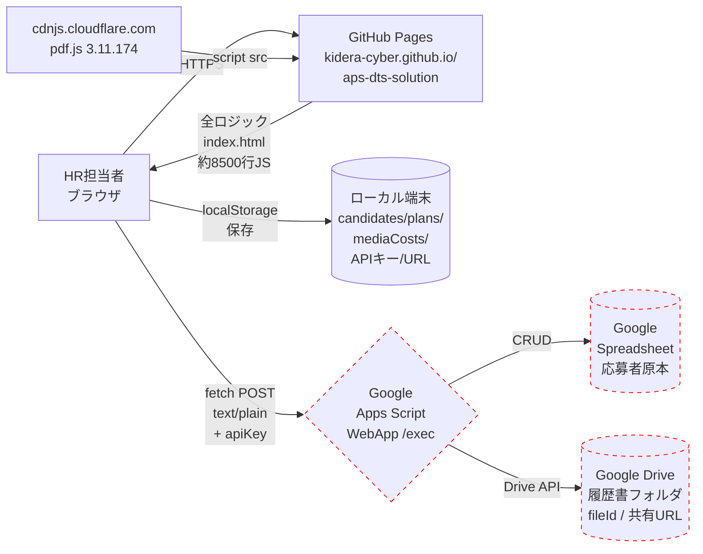

# セキュリティ監査レポート

- 作成日: 2026-10-22
- 対象: 採用管理APS（`kidera-cyber/aps-dts-solution`） ／ PAL採用サイト（`kidera-cyber/pal-recruit-preview`）
- 監査者: Claude（セキュリティ監査アシスタント）
- 監査種別: 読取専用の静的解析＋公開設定確認（本番環境・GAS・スプレッドシート・応募者データは**一切変更していません**）

> 本レポートに記載された判定は、ローカルに取得できる範囲（公開リポジトリの Git 履歴・ソース・GitHub Pages 公開設定）に基づきます。Google Apps Script（以下 GAS）本体のソース、デプロイ設定（アクセスできるユーザー／実行ユーザー）、スプレッドシートの共有設定、Google Drive 上の履歴書フォルダ権限は**本監査からは直接確認できないため「未確認」**として扱い、確認手順を §11 に整理しています。

---

## 1. エグゼクティブサマリー（結論先出し）

| 項目 | 判定 | 一言サマリ |
|---|---|---|
| 採用管理APS 本番運用の可否 | **条件付き可（High リスク未解消）** | ソースに秘密情報は無く仕組みは健全だが、「API Key のみ」でフル権限を与える単純認証モデルのため、HR担当者間でキーを厳格に守れることが前提。GAS側設定の未確認3項目を解消するまで本番拡大は推奨しない |
| PAL採用サイト 安全性 | **可（低リスク）** | 入力フォーム・外部通信・難読化スクリプト・不正スクリプトいずれも検出なし。ESET警告は実コンテンツに由来せず、GitHub Pages サブドメインのレピュテーション／`<meta refresh>` 設置の複合要因による**誤検知の可能性が高い**（断定は不可） |
| ESET「潜在的なフィッシングの試み」原因 | **誤検知の可能性が高い** | フォーム・ログイン・不審JS・不審外部通信いずれも無し。host名に"cyber"を含む `*.github.io` サブドメイン＋`<meta http-equiv=refresh>`＋`noindex`の合成がヒューリスティックに引っかかった可能性大 |
| php2shell の影響 | **非該当** | 両サイトとも GitHub Pages 静的ホスティング＋GAS（JavaScript）構成。PHP バックエンドは一切存在せず、php2shell で論じられる攻撃面は該当しない |

**最優先で解消すべきは次の2点**:
1. GAS Web App の「アクセスできるユーザー」設定を確認する（§11-A）。もし「全員」なら、APIキーが唯一の認証となるため**キー漏洩=全件漏洩**。
2. 現状の「APIキー＝バレアラートークン」モデルを、**最低でも操作者単位のキー発行＋Drive側で履歴書フォルダをアクセス制限する**設計に変更。

---

## 2. 監査対象と確認範囲

### 対象
| 対象 | リポジトリ | 公開URL | 可視性 |
|---|---|---|---|
| 採用管理APS | `kidera-cyber/aps-dts-solution` | https://kidera-cyber.github.io/aps-dts-solution/ | **Public** |
| PAL採用サイト | `kidera-cyber/pal-recruit-preview` | https://kidera-cyber.github.io/pal-recruit-preview/renewal/ | **Public** |

### 確認済み
- APS: 本リポジトリ全体（HEAD）、全コミット履歴、`index.html`（567KB、約8500行、単一ファイル）
- APS: GitHub 公開設定（Pages 配信元・HTTPS強制・ブランチ保護）
- PAL: `renewal/` 配下全HTML（34ファイル）、`assets/app.js`、GitHub Actions ディレクトリ
- 両: 全コミット作者、`.gitignore`、追跡ファイル一覧

### 未確認（本監査では到達不能）
- GAS 本体ソースコード
- GAS Web App デプロイ設定（アクセス権限、実行ユーザー）
- Google スプレッドシートの共有範囲
- Google Drive 上の履歴書フォルダ共有設定
- GitHub 組織／リポジトリの Collaborator / Deploy Key / Secrets 一覧
- 実際の運用時のネットワークリクエスト・CSPヘッダ（GitHub Pages 側）

---

## 3. システム構成図

**赤破線＝本監査では権限設定が未確認の領域**。APS全体のセキュリティはこの3領域の設定に強く依存します。

---

## 4. 採用管理APS 監査結果

### 4-1. 認証・アクセス制御

| # | 項目 | 判定 | 根拠 |
|---|---|---|---|
| A1 | HTML 側ログイン認証 | **なし** | `index.html` 内に `login`/`auth`/`session`/`password` フォーム一切なし。URL を知っている誰でもUIを開ける |
| A2 | GAS 側 API 認証 | **APIキー1本（共有バレアラートークン）** | [index.html:1157-1215](../index.html:1157) の `callCloud()` が、全アクション（save/load/ping/diagnose/uploadResume など）で `payload.key = apiKey` を1本送信するだけ |
| A3 | 操作別認可 | **未確認** | クライアント側は action 名でサーバー処理を分岐。GAS 側で action ごとに権限分離があるかは本リポジトリから判定不能 |
| A4 | ユーザー識別 | **なし** | 誰が操作したかの識別情報は送信していない。監査ログを取るならGAS側で UA / IP ベースで記録することになり厳密な個人追跡は困難 |
| A5 | 開発者ツール経由の直接API | **可能** | HTML から FETCH しているだけなので、ブラウザのdevtoolsやcurlで `{key, action, payload}` を同一エンドポイントに投げれば同じ応答。IDOR（応募者ID差し替え）可否は GAS 実装次第で未確認 |
| A6 | 権限分離（HR / 管理者） | **なし** | 一般HR担当と管理者で分かれた概念が UI にも通信にも存在しない。全操作が同一キーで実行可能 |

**要約**: 認証モデルは「WebApp URL＋APIキーを知る者＝全権限」の**単一セキュリティファクター**です。これはツール内情報として扱えますが、以下に該当する場合は実質的に無防備となります：
- HR担当者のPCが紛失・盗難
- 共有端末で前任者が localStorage を消さないまま退職
- 画面共有・スクリーンショット経由でAPIキー欄が映り込む
- devtools での `localStorage.getItem('aps_api_key')` 実行を知る内部者

### 4-2. APIキー・共有キー管理

| # | 項目 | 判定 | 根拠 |
|---|---|---|---|
| B1 | HTML/JS へのハードコード | **なし** ✓ | 全履歴（58コミット）を `grep -E "AIza[0-9A-Za-z_-]{20,}\|AKIA\|sk_live\|ghp_\|BEGIN.*PRIVATE KEY"` でスキャン、ヒットなし。GAS URL も `placeholder=` のサンプル表記のみ |
| B2 | localStorage 保存 | **あり** | `STORAGE_API_URL = 'aps_api_url'`、`STORAGE_API_KEY = 'aps_api_key'` に平文保存 [index.html:973-981](../index.html:973) |
| B3 | ブラウザ経由でキー取得可 | **可能** | devtools → Application → Local Storage で平文のまま閲覧できる |
| B4 | URLクエリへの秘密情報露出 | **なし** ✓ | 全 fetch は POST、key は body 内 |
| B5 | キーのローテーション／失効 | **UI上なし** | 設定画面で手動で貼り替えは可能。GAS側で古いキーを無効化するには GAS コードの定数書き換え＋再デプロイが必要（UI連動なし） |
| B6 | 公開設定値と秘密値の区別 | **区別なし** | 「API Key」ラベルで入力させるが、本質的には全権アクセスできる Bearer Token |

**改善方向**（§8 で詳述）:
- 短期: 全HR共通キーをやめ、担当者ごとにキーを発行して GAS 側で許可リスト照合
- 中期: GAS WebApp を Google 認証（`Session.getActiveUser()`）に切り替えてキー不要化（組織内GSuiteアカウントで保護）

### 4-3. GAS・スプレッドシート（**未確認重点領域**）

本リポジトリに GAS ソースが含まれないため、以下は**全て未確認**です。本番公開前に必ず手動確認してください。

| # | 項目 | 想定リスク | 確認手順（§11-A） |
|---|---|---|---|
| C1 | WebApp「アクセスできるユーザー」設定 | 「全員」ならキー＋URL があれば誰でもAPI叩ける | GAS editor → デプロイ → デプロイを管理 |
| C2 | WebApp「実行するユーザー」設定 | 「自分」実行なら全操作が所有者権限で走る。Drive全体・個人Gmail へのアクセスまで広がる懸念 | 同上 |
| C3 | doPost 側の key 検証 | 固定値 `=== PropertiesService.getScriptProperties().getProperty('API_KEY')` などで比較しているか。平文比較で単純 if 1行なら OK だが、未検証項目 | GAS ソース閲覧 |
| C4 | action ごとの認可 | `save`/`delete`/`uploadResume` が同一キーで通る実装になっていないか | GAS ソース |
| C5 | スプレッドシート共有範囲 | 「リンクを知っている全員が閲覧可」なら URL 流出だけで全件漏洩 | スプレッドシートの共有ダイアログ |
| C6 | 履歴書Driveフォルダ共有 | 公開リンクなら URL だけで誰でも閲覧／ダウンロード可。クラウド保存URLに `drive.google.com/file/d/<ID>/view` が入っているため、ID が漏れたら即アクセス可能 | Drive フォルダ右クリック → 共有 |
| C7 | スプレッドシート数式インジェクション | CSV 取込で `=HYPERLINK(...)` を含む値が応募者名などに入ると、スプレッドシートで式として展開され開いた人を外部誘導するリスク | 入力テストで `=1+1` などを送信して保存結果を確認 |
| C8 | エラーメッセージ内の情報漏洩 | スタックトレース・内部パスをフロントに返していないか | 不正キーで接続テスト |
| C9 | レート制限／監査ログ | 大量リクエストで GAS 1日実行上限（6分×N）を使い切るDoS相当。失敗記録もなし | GAS 側 LockService / Script Execution ログ |

### 4-4. 個人情報・履歴書の取り扱い

| # | 項目 | 判定 | 根拠 |
|---|---|---|---|
| D1 | 応募者 PII の保存 | ブラウザ localStorage に平文JSON | `JSON.stringify(candidates)` [index.html:1245](../index.html:1245)。name / phone / email / birthDate / memo / resumeUrl が平文で各端末に残る |
| D2 | 履歴書URL の格納 | candidate.resumeUrl として同じく localStorage | 同上。URLに Drive の fileId が入っているため、履歴書フォルダが公開なら URL だけで PDF 閲覧可 |
| D3 | 履歴書ファイル検証 | 拡張子＋サイズのみ | [index.html:4790-4806](../index.html:4790)。magicバイト検査なし。但し攻撃経路は限定的（Drive 側で MIME 判定される） |
| D4 | 通信の HTTPS 強制 | ✓ 強制 | Pages 設定で `https_enforced: true`、GAS も https |
| D5 | 第三者サービスへの意図しない送信 | なし ✓ | ネット通信は `cdnjs.cloudflare.com`（pdf.js）と GAS WebApp のみ。追跡タグ・分析・外部フォーム送信なし |
| D6 | 個人情報の削除手段 | UI 上「全データリセット」「応募経路別削除」「CSV照合削除」「誤取込ロールバック」ありだが、削除は論理ではなく即削除（localStorage＋クラウド） | §4-6 で詳述済 |
| D7 | 退職者端末のクリア手順 | **運用ルール未整備（想定）** | 画面上の案内なし。端末回収時に手動で localStorage をクリアする運用が必要 |
| D8 | 不要PII の長期保存 | 保持期間ルールなし | 不採用者も含めて候補者レコードは明示削除されない限り永続（将来、個人情報保護法上の削除要求に応える仕組みが必要） |

### 4-5. Web アプリケーション全般（OWASP視点）

| # | 項目 | 判定 | 詳細 |
|---|---|---|---|
| E1 | XSS（innerHTML への未エスケープ変数） | **概ね対策済** | 検出箇所の大半で `${escapeHTML(c.name)}` 等が実施されている。例外として `${yen(x)}` は意図的にspanを埋め込むが、`yen()` 自身は内部で `Number().toLocaleString()` を通すため XSS 入口にならない |
| E2 | DOM-based XSS（location.hash 等） | **なし検出** | `location.hash` を innerHTML に差し込む箇所なし |
| E3 | オープンリダイレクト | **なし** | `window.location.href = ...` の動的遷移なし |
| E4 | **javascript: スキーム URL** | **低リスクあり** | 履歴書URL `href="${escapeHTML(c.resumeUrl)}"` [index.html:3525](../index.html:3525) — `escapeHTML` は実行できるが、`javascript:` スキームはそのまま通過しクリック時に実行される。入力元が信頼されたHR担当者のみなので実務影響は小さいが、スキーム allowlist 追加を推奨 |
| E5 | 履歴書 iframe の src | **信頼境界要確認** | `isDrive` 判定は `url.includes('drive.google.com')` の緩い判定。悪意ある URL（例: `evil.com/drive.google.com/`）は includes を通る。allowlist パターン化推奨 |
| E6 | CSP（Content Security Policy） | **未設定** | `<meta http-equiv="Content-Security-Policy">` なし。GitHub Pages 側で CSP ヘッダも付与されない。設定追加で広範な多層防御になる |
| E7 | SRI（Subresource Integrity） | **未設定** | `<script src="https://cdnjs.cloudflare.com/.../pdf.min.js" defer>` に integrity 属性なし。cdnjs 配信ファイル改ざんシナリオに無防備。pin はされているので低リスクだが追加推奨 |
| E8 | iframe フレーム対策（Clickjacking） | **未設定** | X-Frame-Options / `frame-ancestors` 指定なし。GitHub Pages 側で `X-Frame-Options: DENY` が付かないため、第三者が iframe で埋め込んで操作誘導するクリックジャッキング攻撃が理論上可能 |
| E9 | 外部スクリプト | pdf.js のみ ✓ | pinned 3.11.174。既知の重大CVEなし |
| E10 | 依存ライブラリ脆弱性 | `package.json` 存在せず | Dependabot 対象なし。pdf.js のバージョン手動管理 |
| E11 | GitHubリポジトリへの秘密情報混入 | **なし** ✓ | 全履歴スキャン済み（APIキー・GCPキー・PEM・ghp_ トークン等いずれもヒットなし） |
| E12 | ブランチ保護 | **なし** | `main` 直push 可能。レビュー・CIなし |
| E13 | GitHub Actions / Workflows | **なし** | `.github/workflows` 不在 |

### 4-6. CSV取込・削除操作（本監査中に特に注視）

本監査期間中にユーザー要望で実装された「誤取込CSV ロールバック」「CSV照合削除」は適切な安全策を備えている:
- DRY RUN 必須
- 完全バックアップ → atomic 実行 → 失敗時 rollback
- 自動ポーリング停止で古いクラウドによる上書き防止
- `plans / mediaCosts / halfYearMediaTargets` の不変検証
- PLEX 請求書登録済み名の二重削除防止

一方、設定画面の **「全データリセット」** ボタン [index.html:7265](../index.html:7265) は `confirm()` 1回のみで実行可能。誤操作で全応募者が消える可能性があるため、**ダイアログ内に「削除」文字列をタイプさせる確認式**に変更するのが望ましい（Low）。

---

## 5. GAS・スプレッドシート 監査結果

本リポジトリから到達不能のため、**全項目「未確認」**。必ず §11-A の手順で手動確認してください。

想定リスク順:
1. **WebApp のアクセス権限** — 「全員」なら APIキー＋URLだけで全件CRUD可能
2. **スプレッドシート共有** — 「リンクを知っている全員」なら API 経由せずとも URL を知れば閲覧可
3. **Drive 履歴書フォルダ共有** — 公開リンクなら fileId を知るだけで PDF ダウンロード可
4. **doPost 内の key 比較** — 定数文字列比較か、Properties Service 経由か
5. **スクリプトプロパティ** — API_KEY が Properties Service に入っているか、ハードコードか

---

## 6. PAL採用サイト 監査結果

### 6-1. ファイル構成
- `renewal/` 配下: 34個の静的HTMLのみ（合計約 950KB）。JS/CSSなし
- 共通リソース: `assets/style.css`（494KB）、`assets/app.js`（7.97KB）

### 6-2. 検出した内容
| 項目 | 結果 |
|---|---|
| フォーム（`<form>` ／ `<input type="password">`） | **0件** |
| 外部スクリプト | Google Fonts のみ（`fonts.googleapis.com` / `fonts.gstatic.com`） |
| 外部 iframe / 外部画像 | **0件** |
| `eval` / `new Function` / `atob` / `document.write` / 動的 `createElement('script')` | **全て0件** |
| 難読化・base64大ブロック | **0件** |
| `fetch` / `XMLHttpRequest` / `postMessage` / `window.location =` | 全HTML＋`app.js`で **0件** |
| 分析トラッカー（GA / GTM / Facebook Pixel 等） | **0件** |
| `<meta http-equiv="refresh">` | **4件**（`work/fde`, `after-joining`, `jobs/center-manager`, `culture`）— 全て**サイト内相対パスへのリダイレクトスタブ**。コメントで「GitHub Pages は 301 を返せないため」と説明あり |
| OG 情報の第三者ブランド詐称 | **なし** |
| GitHub Actions | ディレクトリ自体不在 |
| Git 履歴の不審コミット | なし。全コミット作者が `kidera-cyber <t_kidera@pal-style.co.jp>` |
| `.env` / `*.key` / credentials 等 | 追跡なし |

### 6-3. 現在のワークツリー状態（情報）
`git status` に以下あり（**本番配信には影響なし**）:
- `D renewal/index.html` — ローカルで削除、HEAD は保持（配信はHEADから）
- `?? "renewal/index 2.html"` — Finder 由来のコピー、untracked なので配信外

今後、意図せず `renewal/index.html` の削除をコミットすると配信先が崩れるため、`git checkout -- renewal/index.html` でローカル状態を戻すことを推奨（**今回は実行していません**）。

---

## 7. ESET警告「潜在的なフィッシングの試み」調査

### 7-1. 分類

| カテゴリ | 結果 |
|---|---|
| CONFIRMED（確実な危険コード） | **0件** |
| SUSPICIOUS（怪しいが結論不可） | 3件 — ①内部用 `<meta refresh>` 4ページ、②サイトワイド `noindex,nofollow` + `robots.txt Disallow: /`、③サブドメイン名 `kidera-cyber.github.io`（"cyber" 文字列） |
| NOT FOUND（確認し検出なし） | フォーム／パスワード入力／クレデンシャル送信／外部POST／難読化／base64／動的script注入／第三者 iframe・画像／アナリティクス／ブランド詐称／隠しキーワード／admin ページ露出／Workflow Secrets／tracked `.env`／HTTP混在 |

### 7-2. 判定

**実際に危険なコード・設定は見つかりませんでした**。ただし「100% 誤検知」とは断定できません（セキュリティ製品のレピュテーション判定は内部ロジックが公開されていないため）。

**最有力の原因**: GitHub Pages 共有サブドメインのレピュテーション悪化 + "cyber" 文字列 + `<meta refresh>` + `noindex` の複合ヒューリスティック。

### 7-3. ESET 再判定依頼時に提出すべき情報

1. URL: `https://kidera-cyber.github.io/pal-recruit-preview/renewal/`
2. ホーム（`renewal/index.html`）と Entry ページ（`renewal/entry/index.html`、応募ボタン無効化中）のフルページスクリーンショット
3. 文言: 「株式会社PAL の静的採用プレビューサイト。フォーム・認証情報入力・外部データ送信は一切ありません」
4. 外部ロードする全ホスト一覧:
   - `fonts.googleapis.com` / `fonts.gstatic.com`（Google Fonts、CSSのみ）
   - 他ホストへのネットワーク送信: **なし**
   - 外部リンク（anchor のみ、自動遷移なし）: `www.pal-style.co.jp`、`www.youtube.com`
5. ソース公開リンク: `https://github.com/kidera-cyber/pal-recruit-preview`（Public, `main` branch）
6. 「GitHub Pages は 301 を返せないため `<meta refresh>` を 4ページで使用。すべてサイト内相対パスへのリダイレクト」の説明
7. 連絡先: `t_kidera@pal-style.co.jp`

### 7-4. 対応時の禁止事項
- セキュリティ警告を無視してアクセス継続しないこと
- ESET の保護機能を無効化しないこと

---

## 8. php2shell 関連性

| 対象 | 判定 | 理由 |
|---|---|---|
| APS | **非該当** | GitHub Pages = 静的HTML配信（PHP実行不可）。バックエンドは Google Apps Script（Google 製 JavaScript ランタイム）。PHP は一切使っていない |
| PAL | **非該当** | 同上。PHP 実行環境なし |

php2shell で論じられる PHP ファイルアップロード → RCE 攻撃面は、両サイトのアーキテクチャに存在しません。

---

## 9. リスク一覧

| No. | 対象 | 診断項目 | 判定 | 重要度 | 根拠 | 対応 |
|---|---|---|---|---|---|---|
| R-01 | APS | GAS WebApp アクセス権限 | 未確認 | **High（確認必須）** | GAS設定が本リポジトリ外 | §11-A C1 で確認 |
| R-02 | APS | スプレッドシート共有範囲 | 未確認 | **High（確認必須）** | 同上 | §11-A C5 |
| R-03 | APS | Drive 履歴書フォルダ共有 | 未確認 | **High（確認必須）** | 同上 | §11-A C6 |
| R-04 | APS | API Key が全HR共通 Bearer Token | 設計リスク | **High** | [index.html:1157-1215](../index.html:1157) | §8 短期案 |
| R-05 | APS | PII が localStorage に平文永続 | 設計リスク | **Medium** | [index.html:1245](../index.html:1245) | 運用ルール＋Logout UI |
| R-06 | APS | CSP / SRI 未設定 | 多層防御不足 | **Medium** | HTML `<head>` 内 | `<meta>` CSP追加・script `integrity=` 追加 |
| R-07 | APS | 履歴書URL href スキーム検証なし | 低確率XSS | **Medium** | [index.html:3525](../index.html:3525) | `javascript:` スキーム除外 |
| R-08 | APS | iframe isDrive 判定が緩い | 誤判定リスク | **Medium** | [index.html:3522](../index.html:3522) | `startsWith('https://drive.google.com/')` に |
| R-09 | APS | `main` ブランチ保護なし | 誤push／改ざん容認 | **Medium** | gh branches API | Require PR + review |
| R-10 | APS | リポジトリ Public | 情報開示 | **Low** | public visibility | 機密ロジックではないが Private 検討可 |
| R-11 | APS | 「全データリセット」1クリック | 誤操作 | **Low** | [index.html:7265](../index.html:7265) | 確認文字列入力式に |
| R-12 | APS | X-Frame-Options 未設定 | クリックジャッキング | **Low** | GitHub Pages | CSP の `frame-ancestors 'none'` で代替 |
| R-13 | APS | Clipboard 等その他 | — | — | 検出なし | — |
| R-14 | PAL | 4ページで `<meta refresh>` | AV誤検知誘因 | **Low** | `work/fde`等 | 可能なら JavaScript 側で canonical だけ更新 |
| R-15 | PAL | `renewal/index 2.html` が workdir に存在 | 配信外・事故源 | **Low** | git status | ローカル削除（本監査では非実施） |
| R-16 | 両 | GAS以外のサーバーサイド処理 | **なし** ✓ | — | 全履歴検査 | — |
| R-17 | 両 | 秘密情報のコミット | **なし** ✓ | — | 全履歴検査 | — |

---

## 10. 修正計画

### 即時対応（情報漏えいに直結、本番公開前必須）

| 優先度 | 修正対象 | 修正内容 | 既存機能への影響 | 担当 |
|---|---|---|---|---|
| P0 | GAS WebApp デプロイ設定 | 「アクセスできるユーザー」を「全員」から「全員（匿名）」ではなく、できれば**Googleアカウント必須**に変更。移行コストが高いなら最低限 `doPost` の先頭で key 検証を**定数時間比較**（`crypto.timingSafeEqual` 相当を Apps Script で実装）に強化し、失敗時はログに記録してから `return` | APIキー運用自体は維持可。ドメイン制限なら HR の Google アカウント追加操作が必要 | 管理者 |
| P0 | スプレッドシート共有 | 「リンクを知っている全員」になっていないか確認し、必要なら「特定ユーザー」のみに限定 | HR 全員のアカウントを明示的に共有者追加する必要あり | 管理者 |
| P0 | Drive 履歴書フォルダ共有 | 公開リンクではなく「特定ユーザー」限定に。ファイル個別の `anyone-with-link` 設定も棚卸し | 既存の `resumeUrl` のうち public 共有に依存しているものは要再設定 | 管理者 |

### 短期対応（1〜2週以内）

| 優先度 | 修正対象 | 修正内容 | 既存機能への影響 | 担当 |
|---|---|---|---|---|
| P1 | APIキー運用 | 全HR共通の1本キー → 担当者ごとに個別キーを発行し、GAS の Script Properties に許可リストとして保存。退職時はそのキーだけ失効 | 設定画面の UI は変更不要。GAS の doPost で `payload.key in allowedKeys` に変更 | 開発＋管理者 |
| P1 | CSP メタタグ追加 | `<meta http-equiv="Content-Security-Policy" content="default-src 'self'; script-src 'self' https://cdnjs.cloudflare.com; style-src 'self' 'unsafe-inline'; img-src 'self' data: https://drive.google.com; frame-src https://drive.google.com; connect-src https://script.google.com; frame-ancestors 'none'">` | 現状と同じ機能範囲を維持。インラインstyle使用のため `style-src 'unsafe-inline'` は残す | 開発 |
| P1 | SRI 追加 | `<script src="…/pdf.min.js" integrity="sha384-…" crossorigin="anonymous" defer>` | 既存機能に影響なし | 開発 |
| P1 | 履歴書URL スキーム検証 | `isSafeUrl(url) = /^https?:\/\//i.test(url) && !url.toLowerCase().startsWith('javascript:')` を導入し、href 生成前にチェック | 正常な http(s) URL は従来通り | 開発 |
| P1 | iframe isDrive 判定 | `/^https:\/\/drive\.google\.com\/.*/.test(url)` に厳密化 | 既存の Drive URL は影響なし | 開発 |
| P1 | main ブランチ保護 | GitHub Settings → Branches → `main` に Require PR / Require review を設定 | 直push 不可になる。1人運用なら「Require 1 approving review」は外し「Require status checks」のみ有効化も可 | 管理者 |
| P1 | 「全データリセット」確認強化 | ダイアログで「DELETE」文字列入力を必須化 | 1クリック削除廃止、確認工程増加 | 開発 |

### 中長期対応（1〜3ヶ月）

| 優先度 | 修正対象 | 修正内容 | 既存機能への影響 | 担当 |
|---|---|---|---|---|
| P2 | 認証モデル刷新 | GAS WebApp を Google 認証（Workspace ドメイン限定）に切替、APIキー廃止。`Session.getActiveUser().getEmail()` で許可メール照合 | ブラウザ側の `apiKey` 入力欄が不要に。初回アクセス時に Google 認可画面が出る。クロスオリジンでは Cookie 送信できないため `userContext=iframe` 等の実装調整が必要 | 開発＋管理者 |
| P2 | 操作監査ログ | GAS 側で全 action をスプレッドシート "AuditLog" シートに記録（操作者メール・action・timestamp・影響件数） | DB 容量少々増加。閲覧時は管理者のみ | 開発 |
| P2 | PII 保持期間ルール | 不採用／辞退から N 日後に candidate を自動アーカイブ・削除する GAS バッチ | 保持期間を越える履歴の照会不可（別途アーカイブへ） | 管理者 |
| P2 | X-Frame-Options 代替 | CSP の `frame-ancestors 'none'` を上記 CSP に含めることで対応 | 自サイトを iframe 埋め込みする画面がある場合は要調整 | 開発 |
| P2 | ログアウト UI | 設定画面に「このブラウザから設定とキャッシュを削除」ボタンを追加し、localStorage 全消去 | 退職者端末のクリア手順が明確化 | 開発 |

### 動作確認項目（修正適用後）
- 設定タブ → 接続確認が成功する
- 応募者一覧の取得・更新・削除が従来通り
- CSV取込、JSONバックアップ、PDF請求書解析が従来通り
- 履歴書アップロード・プレビュー表示が従来通り
- 月次レポート、ダッシュボードの各KPI数値が修正前後で一致
- 新CSPで `console` に CSP違反エラーが出ないこと

---

## 11. 未確認事項・追加確認手順

### A. GAS / スプレッドシート確認手順

管理者本人が実施してください。

1. **GAS editor を開く**（`script.google.com` → 対象プロジェクト）
   - [C1] 右上「デプロイ → デプロイを管理」→ 既存デプロイを選択 → 「アクセスできるユーザー」の値を確認
   - [C2] 同画面の「次のユーザーとして実行」の値を確認
   - [C3] `コード.gs`（または `doPost.gs`）を開き、`doPost(e)` 関数の先頭で key 検証を行っているか確認。例えば `if (payload.key !== PropertiesService.getScriptProperties().getProperty('API_KEY')) return err(...)` のような1行があるか
   - [C4] 同関数内で action 名ごとの処理分岐と、権限レベル差（例: `deleteAll` に別キー）があるか
   - [C9] 「実行数」ページ（左ナビ）→ 最新実行で異常なエラー多発がないか

2. **スプレッドシート共有確認**
   - 対象スプレッドシートを開く → 右上「共有」ボタン → 「一般的なアクセス」の設定を確認
   - [C5] 「リンクを知っている全員」になっていないか。「制限付き」＋HR担当者メールの明示列挙が理想

3. **Drive 履歴書フォルダ**
   - GAS の `uploadResume` が保存先として指定しているフォルダを特定し、Drive で開く
   - [C6] 右クリック → 共有 → 「一般的なアクセス」が「制限付き」であること

4. **数式インジェクションテスト**
   - [C7] 応募者名欄に `=HYPERLINK("https://example.com","CLICK")` と入力して保存 → スプレッドシートで式として展開されたら対策必要

### B. GitHub 側の追加確認

5. **Collaborator 一覧**
   - GitHub → `kidera-cyber/aps-dts-solution` → Settings → Collaborators → 不要なアカウントがいないか
6. **Deploy keys / Secrets / Dependabot alerts**
   - Settings → Secrets and variables → 使用していない Secret がないか
   - Settings → Code security → Dependabot alerts を有効化
7. **Audit log**（Organizations 配下なら）
   - 最近30日の変更をスキャン

### C. 実運用時のネットワーク確認

8. ブラウザ devtools で `document.cookie`、`localStorage`、`Network`タブ を確認し、意図しないドメインへのリクエスト／意図しないデータ送信がないかを本番トラフィックで検証（本監査では未実施）
9. ESET 側のレピュテーション再判定依頼（§7-3）

---

## 12. 最終判断（マーケティング担当者向けQ&A）

| # | 質問 | 判定 | 理由 |
|---|---|---|---|
| 1 | 現在の採用管理APSに実際の応募者情報を登録しても問題ないか | **条件付き可** | §11-A の C1〜C6（GAS権限・スプレッドシート共有・Drive共有）を**管理者が確認し、「全員」設定を解消してから**なら許容可能。未確認のまま本番運用拡大は非推奨 |
| 2 | 第三者に応募者データを見られる可能性はあるか | **条件次第** | APIキーが流出した場合は全件漏洩し得る。現状の設計は「HR担当者がキーを厳格に管理し、端末が盗難・共用でない」ことを前提とする。GAS権限が「全員」のままなら、URLとキーを知る誰もがアクセス可能 |
| 3 | GitHub Pages で採用管理APSを運用し続けても問題ないか | **可（運用注意）** | 静的配信自体は適切。ただしリポジトリが Public なためアプリ構造が公開情報となる点を受容できるならOK。機密ロジックではない |
| 4 | Google Apps Script + スプレッドシートの構成を維持できるか | **可（設定強化前提）** | 構成自体は小規模組織向けには妥当。設定強化（§11-A）＋APIキーの個別化（P1）を実施すれば現実的な運用レベル |
| 5 | PAL採用サイトのESET警告にどう対応すべきか | **誤検知として ESET に再判定依頼**（§7-3） | 実コンテンツに問題なし。暫定的には社内PCでアクセス時に ESET 管理者が例外登録。再判定で解消を試みる |
| 6 | どの修正を最優先にするべきか | **GAS 側3設定（§10 P0）→ APIキー個別化（P1）→ CSP/SRI（P1）** | 直接的な情報漏洩に効くものから順に |

---

## 付録 A: 本監査で実行した読取専用コマンド例
- `git log --all --oneline`、`git ls-files`、`git grep -nIE "<secret pattern>"`
- `gh repo view … --json`、`gh api repos/.../pages`、`gh api repos/.../branches/main/protection`
- `grep -nE "..."` によるソース検索（innerHTML / fetch / eval / localStorage 等）
- Explore サブエージェントによる PAL リポジトリの静的解析

## 付録 B: 実行していない操作（監査制約）
- 本番環境・GAS・スプレッドシート・Driveへの書込／権限変更／削除
- GitHub への push／PR 作成／Workflow 実行／Secret 変更
- 応募者データの取得・複製・外部送信
- 侵入テスト・ブルートフォース・大量リクエスト
- ESET 警告の回避・無効化

---

### 本レポートに秘密情報は含まれていません
- APIキー・パスワード・応募者 PII・GAS URL・内部 ID 等の実値は一切記載していません
- 「ハードコード秘密情報は検出なし」と記載したスキャンでも、万一ヒットした場合はファイル名／行番号／種別のみ記述する運用でした（本件では該当なし）
